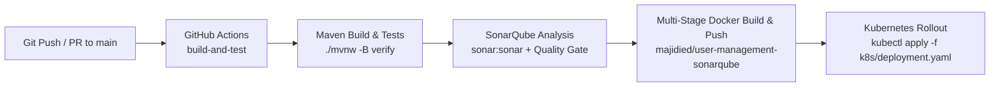

# User Management — Spring Boot CI/CD with SonarQube, Docker & Kubernetes


A **Spring Boot User Management** web application (Spring MVC, Spring Security, Thymeleaf, Spring Data JPA, PostgreSQL) wired into an automated **GitHub Actions CI/CD pipeline** featuring **Maven builds & unit tests**, **SonarQube** static code analysis, **Docker** containerization, and **Kubernetes** deployment manifests.

> **Project Status:** Completed DevOps / DevSecOps CI/CD lab. Local PostgreSQL Compose setup, multi-stage `Dockerfile`, externalized DB configuration, Kubernetes manifests (`k8s/deployment.yaml`), and GitHub Actions workflow (`build-and-deploy.yml`) are configured and ready.

---

## CI/CD Pipeline Architecture



---

## Tech Stack

- **Backend & UI:** Java 21, Spring Boot 3.3.4, Spring Security 6, Spring Data JPA, Thymeleaf, Lombok
- **Database:** PostgreSQL (`local-environment/docker-compose.yml` for local development)
- **Code Quality & Security:** SonarQube (`sonar-project.properties`), Dependabot (`.github/dependabot.yml`)
- **Containers & Orchestration:** Multi-stage Docker (`maven:3.9-eclipse-temurin-21` → `eclipse-temurin:21-jre-alpine`), Kubernetes (`k8s/deployment.yaml`)
- **CI/CD:** GitHub Actions ([`.github/workflows/build-and-deploy.yml`](.github/workflows/build-and-deploy.yml))

---

## Getting Started

### 1. Clone the Repository
```bash
git clone https://github.com/Majidied/user-management-sonarqube.git
cd user-management-sonarqube
cp .env.example .env
```

### 2. Start Local PostgreSQL (Docker Compose)
```bash
docker compose -f local-environment/docker-compose.yml up -d
```

### 3. Run the Application Locally
```bash
./mvnw clean spring-boot:run
```
Open `http://localhost:8080` in your browser.

### 4. Run Unit Tests & Package
```bash
./mvnw -B verify
```

### 5. Run SonarQube Analysis Locally
```bash
./mvnw -B verify sonar:sonar \
  -Dsonar.host.url=http://localhost:9000 \
  -Dsonar.token=<YOUR_SONAR_TOKEN>
```

### 6. Build & Run with Docker
```bash
docker build -t user-management-sonarqube:local .
docker run -p 8080:8080 \
  -e DB_URL=jdbc:postgresql://host.docker.internal:5444/user-management-db \
  -e DB_USERNAME=root \
  -e DB_PASSWORD=root \
  user-management-sonarqube:local
```

---

## Configuration

Database connection settings are externalized in [`src/main/resources/application.properties`](src/main/resources/application.properties):

| Variable | Default | Description |
| :--- | :--- | :--- |
| `DB_URL` | `jdbc:postgresql://localhost:5444/user-management-db` | PostgreSQL JDBC connection URL |
| `DB_USERNAME` | `root` | Database username |
| `DB_PASSWORD` | `root` | Database password |
| `JPA_DDL_AUTO` | `update` | Hibernate DDL strategy |
| `JPA_SHOW_SQL` | `false` | Toggle SQL logging |

GitHub Actions secrets used by the deployment job in [`.github/workflows/build-and-deploy.yml`](.github/workflows/build-and-deploy.yml):
- `SONAR_HOST_URL` & `SONAR_TOKEN` — SonarQube server URL and project analysis token
- `DOCKER_USERNAME` & `DOCKER_PASSWORD` — Container registry credentials
- `KUBECONFIG_CONTENT` — Kubeconfig for cluster deployment (`kubectl apply -f k8s/deployment.yaml`)

---

## Application Screenshots

| Registration Page | Login Page |
| :---: | :---: |
|  |  |

| User List Page | User Information Page |
| :---: | :---: |
|  |  |

---

## Project Structure

```text
user-management-sonarqube/
├── .github/
│   ├── dependabot.yml                   # Automated Maven & Actions dependency updates
│   └── workflows/
│       └── build-and-deploy.yml         # CI/CD: Maven, SonarQube, Docker & K8s rollout
├── img/                                 # Application screenshots
├── k8s/
│   └── deployment.yaml                  # Kubernetes Deployment & ClusterIP Service (port 8080)
├── local-environment/
│   └── docker-compose.yml               # Local PostgreSQL container (port 5444)
├── src/
│   ├── main/java/com/hendisantika/usermanagement/
│   └── test/java/com/hendisantika/usermanagement/
├── .env.example
├── .gitignore
├── Dockerfile                           # Multi-stage Maven + Eclipse Temurin 21 JRE Alpine build
├── LICENSE                              # MIT License
├── mvnw / mvnw.cmd
├── pom.xml
└── sonar-project.properties             # SonarQube scanner metadata & source paths
```

---

## Attribution & License

- Base Spring Boot / Thymeleaf application adapted from [`hendisantika/user-management`](https://github.com/hendisantika/user-management), extended with PostgreSQL integration, externalized configuration, multi-stage Docker packaging, SonarQube quality checks, Kubernetes manifests, and GitHub Actions CI/CD.
- Licensed under the [MIT License](LICENSE).
